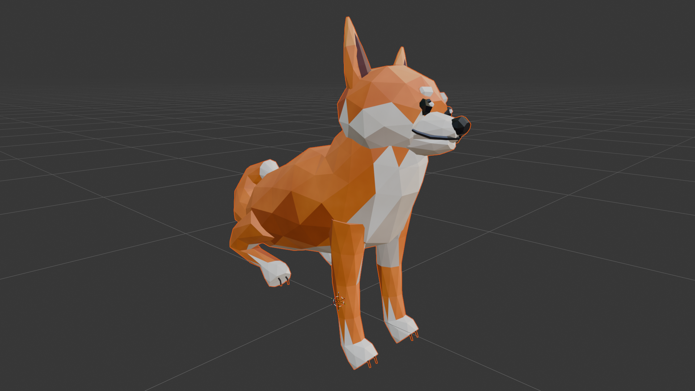
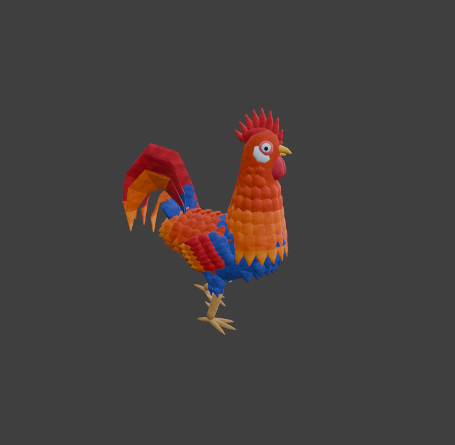

# Cozy Power-Wash 3D Character Assets (`3dmodels`)

This repository contains stylized, game-ready **3D Character Assets** modeled, rigged, shaded, and animated in **Blender 5.2** for a **Cozy Power-Wash Game**:
1. **Expressive Low-Poly Shiba Inu (`cozy_shiba_inu.*`)** — Faceted origami/papercraft-style Shiba Inu companion with a **34-bone expressive quadruped + facial rig** and **15 interactive animations** (sitting smile, petting head bliss, belly rub roll-over, double bark, fetch play-bow, gallop, ball pickup/drop, water-spray chomp, shake-off water, paw trick, ear scratch, sniffing dirt, and curled nap).
2. **Stylized Rooster (`cozy_powerwash_rooster.*`)** — Layered shingle-feathered Rooster with a **28-bone rig** and **7 animations** (idle look-around, peck & scratch, proud walk strut, startled hop, shake-off water, panic run flee, and celebratory crow).

---

# Part 1: Expressive Low-Poly Shiba Inu (`cozy_shiba_inu`)

> **Full Shiba Inu Documentation & State Machine Guide:** See **[`SHIBA_INU_README.md`](SHIBA_INU_README.md)** for the complete animation transition graph, posture gating rules, gameplay sequence recipes, and forbidden transition table.



## 1.1 Exported Shiba Inu Files in `C:\3dassets\argon`

| File | Format | Rigged | Animated | Materials | Best Used For |
| :--- | :--- | :---: | :---: | :---: | :--- |
| `cozy_shiba_inu.blend` | **Blender 5.2 Native** | Yes (34 Bones) | Yes (15 Actions + NLA) | Yes (11 Shaders) | Master source file, 1-click viewport playback UI, editing & re-exporting |
| `cozy_shiba_inu.glb` | **glTF 2.0 Binary** | Yes | Yes (All 15 Clips) | Yes | **Godot 4, Three.js, Babylon.js, Unreal Engine 5, Unity (glTFast)** |
| `cozy_shiba_inu.gltf` + `.bin` | **glTF 2.0 Separate** | Yes | Yes (All 15 Clips) | Yes | Inspectable JSON glTF pipelines & custom engine importers |
| `cozy_shiba_inu.fbx` | **Autodesk FBX** | Yes | Yes (Baked Actions + NLA) | Yes | **Unity, Unreal Engine 5, Maya, 3ds Max, Houdini** |
| `cozy_shiba_inu.usdc` | **Universal Scene Description (USD)** | Yes | Yes | Yes | **NVIDIA Omniverse, Unreal Engine 5 Stage, Apple Reality Composer** |
| `cozy_shiba_inu.abc` | **Alembic Cache** | Vertex Cache | Yes (`Frames 1–72`) | Material Slots | VFX vertex-cache playback, Cinema 4D, Houdini |
| `cozy_shiba_inu.obj` + `.mtl` | **Wavefront OBJ + MTL** | Static | Static | Yes | Static prop placement, Substance Painter, ZBrush, Marmoset |
| `cozy_shiba_inu.ply` | **Stanford PLY** | Static | Static | Normals + UVs | Mesh inspection & procedural pipelines |
| `cozy_shiba_inu.stl` | **Stereolithography STL** | Static | Static | Geometry Only | 3D printing & collision hull generation |

## 1.2 Shiba Inu Geometry & Topology Specifications
- **Object Name:** `Shiba_Mesh` (parented to `Shiba_Rig` inside the `Cozy_Shiba` collection)
- **Vertex Count:** `1,094` vertices | **Polygon / Face Count:** `1,750` crisp flat-shaded triangles/quads
- **Art Style & Anatomical Details:**
  - **Crisp Faceted Low-Poly ("Origami/Papercraft") Topology:** Built with half-stepped diamond-triangulated rings (`smooth=False`) so every facet catches light cleanly like the reference illustration.
  - **Authentic Shiba Inu *Urajiro* Color-Blocking:** Warm ginger-orange coat on the crown, ears, back, and outer legs paired with cream-white cheeks, muzzle sides, "pip" eyebrow spots, proud chest shield, belly, inner tail curl, and white-socked paws with dark toe grooves.
  - **Expressive Face:** Glossy dark almond eyes with bright white corneal catchlight sparkles, rigged upper eyelids (`Eyelid.L/R`), rigged white eyebrow spots (`Brow.L/R`), pointed triangular ears with dark espresso-rose inner hollows (`Ear.L/R`), glossy black faceted nose with philtrum line, smiling mouth corners, and an articulated lower `Jaw` + pink `Tongue`.

## 1.3 Shiba Inu Material Slots (11 Scene-Linear Shaders)

| Slot | Material Name | Visual Area | sRGB Hex Range | Roughness |
| :---: | :--- | :--- | :--- | :---: |
| `0` | `Mat_Shiba_Ginger` | Main ginger-orange coat (crown, back, flanks, outer legs, tail) | `#D1631F` → `#F0822E` | `0.50` |
| `1` | `Mat_Shiba_AmberShadow` | Shaded amber-rust facets (back of skull, lower flanks, ear backs) | `#A64517` → `#C7571F` | `0.54` |
| `2` | `Mat_Shiba_GoldenLight` | Sunlit golden-apricot facets (forehead, top back, tail crest) | `#EB8733` → `#FCA847` | `0.48` |
| `3` | `Mat_Shiba_CreamWhite` | Urajiro markings (cheeks, muzzle, eyebrows, chest shield, white paws, tail tip) | `#E8DBCA` → `#FCF5E8` | `0.46` |
| `4` | `Mat_Shiba_CreamShadow` | Shaded cream facets (under-chin, lower chest, belly, inner thighs) | `#BFAB96` → `#DBC9B5` | `0.52` |
| `5` | `Mat_Shiba_EarInner` | Dark espresso-rose inner ear cavity triangles | `#421F21` → `#612E2E` | `0.58` |
| `6` | `Mat_Shiba_NoseBlack` | Glossy charcoal-black nose, philtrum, eyelids, and smiling mouth line | `#0D0D12` → `#1C1F26` | `0.22` |
| `7` | `Mat_Shiba_EyeDark` | Glossy dark ebony almond eyes | `#08080D` → `#12121A` | `0.10` |
| `8` | `Mat_Shiba_EyeSpec` | Pure bright white corneal catchlight sparkles | `#F5FAFF` → `#FFFFFF` | `0.05` |
| `9` | `Mat_Shiba_TonguePink` | Rosy coral-pink tongue inside the lower jaw | `#D15261` → `#F07580` | `0.35` |
| `10` | `Mat_Shiba_PawPad` | Dark slate-brown paw pads and toe claw dividers | `#2E2421` → `#40332E` | `0.65` |

## 1.4 Shiba Inu Rig Hierarchy (`Shiba_Rig` — 34 Bones)

```text
Root
 └── Hips
      ├── Spine
      │    └── Chest
      │         ├── Neck
      │         │    └── Head
      │         │         ├── Snout
      │         │         ├── Jaw ──> Tongue
      │         │         ├── Ear.L / Ear.R
      │         │         ├── Brow.L / Brow.R
      │         │         └── Eyelid.L / Eyelid.R
      │         ├── Leg_Front_Upper.L ──> Leg_Front_Lower.L ──> Paw_Front.L
      │         └── Leg_Front_Upper.R ──> Leg_Front_Lower.R ──> Paw_Front.R
      ├── Tail_Base ──> Tail_Mid ──> Tail_Tip
      ├── Leg_Back_Upper.L ──> Leg_Back_Lower.L ──> Paw_Back.L
      └── Leg_Back_Upper.R ──> Leg_Back_Lower.R ──> Paw_Back.R
```

## 1.5 Shiba Inu Animations (15 Interactive Clips @ 24 FPS)

| # | Action Name | Frames | Duration | Loop | Cozy Gameplay & Player Interaction Behavior |
| :-: | :--- | :---: | :---: | :---: | :--- |
| **1** | `Idle_Sit_Smile` | `1 – 72` | **3.00 sec** | Yes | **Reference Pose!** Sitting politely with proud chest, warm smile, soft tail wag, and curious Shiba head-tilts. |
| **2** | `Idle_Stand_Pant` | `1 – 60` | **2.50 sec** | Yes | Standing on all fours, happy panting (`Jaw` + `Tongue`), perky ears, and curled tail wagging. |
| **3** | `Pet_Head_Bliss` | `1 – 60` | **2.50 sec** | Yes | **When petted on the head!** Leans head up into the player's hand, folds "airplane ears" horizontally back, squints eyes shut (`Eyelid.L/R`), and wags tail double-speed. |
| **4** | `Belly_Rub_RollOver` | `1 – 72` | **3.00 sec** | One-Shot | **Extended petting reward!** Rolls onto its back with front paws tucked on its chest, tongue lolling out, and right hind leg kicking rhythmically in bliss. |
| **5** | `Speak_Double_Bark` | `1 – 40` | **1.67 sec** | One-Shot | **Interactive Bark ("Arf! Arf!")!** Anticipation crouch followed by two snappy barks with chest puff, head toss, jaw snap, and ear perk. |
| **6** | `Give_Paw_Trick` | `1 – 48` | **2.00 sec** | One-Shot | Sits politely and lifts its right front white-socked paw high to shake hands with the player. |
| **7** | `Play_Bow_Excited` | `1 – 48` | **2.00 sec** | Yes | **Fetch Ready Pose!** Drops front elbows flat to the ground while keeping rear hips high in the air, bouncing and wagging its tail waiting for the throw. |
| **8** | `Pickup_Drop_Ball` | `1 – 36` | **1.50 sec** | One-Shot | Dips chest and neck between front paws, opens `Jaw` wide to grab or drop a ball, then lifts head up proudly. |
| **9** | `Walk_Jaunty_Trot` | `1 – 24` | **1.00 sec** | Yes | Bouncy diagonal 4-legged Shiba trot (`Front.L + Back.R` alternating with `Front.R + Back.L`). |
| **10** | `Run_Fetch_Gallop` | `1 – 18` | **0.75 sec** | Yes | Fast, energetic 4-legged rotary gallop with full spine flexion/extension to chase the ball. |
| **11** | `Play_Chomp_Spray` | `1 – 48` | **2.00 sec** | One-Shot | **Power-Wash Interaction!** Hops up on hind legs and playfully snaps/chomps its jaw left and right at the water mist. |
| **12** | `Shake_Off_Water` | `1 – 48` | **2.00 sec** | One-Shot | **After getting wet!** Wide-stance crouch with a phase-delayed high-frequency axial shake rippling from head -> ears -> chest -> hips -> tail. |
| **13** | `Scratch_Ear_Itch` | `1 – 54` | **2.25 sec** | One-Shot | Sits, leans head and neck to the right with right eye squinted shut, and rapidly thumps its right hind paw behind its ear. |
| **14** | `Sniff_Find_Dirt` | `1 – 60` | **2.50 sec** | One-Shot | **Cozy Gameplay Helper!** Lowers nose to the floor sweeping left-and-right sniffing the ground, then perks up and points with its front left paw raised at hidden dirt! |
| **15** | `Sleep_Curl_Nap` | `1 – 84` | **3.50 sec** | Yes | Lies flat on its belly with paws tucked, head curled toward its tail, eyes closed, breathing slowly with an occasional cute ear twitch. |

## 1.6 Shiba Inu Animation State Machine & Posture Gating Rules

Every animation belongs to a specific **Base Posture Group**, and transitions must be routed through two core **Hub States** so the dog never teleports between incompatible poses (e.g., never transition directly from `Run_Fetch_Gallop -> Scratch_Ear_Itch`):

1. **`Idle_Stand_Pant` (Standing Hub — `speed == 0`, 4 paws on ground):**
   - **Locomotion Blend Space (`0.18s–0.22s`):** `Idle_Stand_Pant (speed=0.0)` $\leftrightarrow$ `Walk_Jaunty_Trot (speed=0.5)` $\leftrightarrow$ `Run_Fetch_Gallop (speed=1.0)`.
   - **Standing Actions (`0.20s–0.25s`, only when `speed == 0`):** `Play_Bow_Excited`, `Speak_Double_Bark`, `Pickup_Drop_Ball`, `Sniff_Find_Dirt`, `Play_Chomp_Spray` $\rightarrow$ `Shake_Off_Water`.
2. **`Idle_Sit_Smile` (Sitting Hub — `speed == 0`, rear haunches on ground `dz = -0.175 m`):**
   - Bridges to/from `Idle_Stand_Pant` via a **`0.35s` Sit/Stand transition** when `speed == 0`.
   - **Sitting Actions (`0.25s`, only from `Idle_Sit_Smile`):** `Pet_Head_Bliss` ($\rightarrow$ `Belly_Rub_RollOver` after `3s` of petting), `Give_Paw_Trick`, `Scratch_Ear_Itch`, and `Sleep_Curl_Nap` (`0.50s` settle).
3. **Example Multi-Step Transition (`Running -> Scratch Ear`):**
   - **Forbidden:** `Run_Fetch_Gallop -> Scratch_Ear_Itch` (causes mid-air pelvis drop & hind-leg teleportation).
   - **Correct Chain:** `Run_Fetch_Gallop` $\xrightarrow{0.20\text{s}}$ `Walk_Jaunty_Trot` $\xrightarrow{0.20\text{s}}$ `Idle_Stand_Pant` $\xrightarrow{0.35\text{s}}$ `Idle_Sit_Smile` $\xrightarrow{0.25\text{s}}$ `Scratch_Ear_Itch`.
   - Full state machine diagram and gameplay sequence recipes are documented in **[`SHIBA_INU_README.md`](SHIBA_INU_README.md)**.

---

# Part 2: Stylized Cozy Rooster (`cozy_powerwash_rooster`)



## 2.1 Exported Rooster Files in `C:\3dassets\argon`
- `cozy_powerwash_rooster.blend`, `.glb`, `.gltf` + `.bin`, `.fbx`, `.usdc`, `.abc`, `.obj` + `.mtl`, `.ply`, `.stl`
- **Topology:** `16,774` vertices | `18,828` faces | **Rig:** `Rooster_Rig` (28 Bones) | **Materials:** 14 Hand-Painted Procedural Node Shaders
- **7 Animations (@ 24 FPS):**
  1. `Idle_LookAround` (`1–80`, `3.33s` Loop)
  2. `Peck_Scratch` (`1–70`, `2.92s` Loop)
  3. `Walk_Strut` (`1–32`, `1.33s` Loop)
  4. `Startled_Hop` (`1–36`, `1.50s` One-Shot)
  5. `Shake_Off_Water` (`1–50`, `2.08s` One-Shot)
  6. `Run_Flee` (`1–16`, `0.67s` Loop)
  7. `Happy_Crow` (`1–75`, `3.13s` One-Shot)
