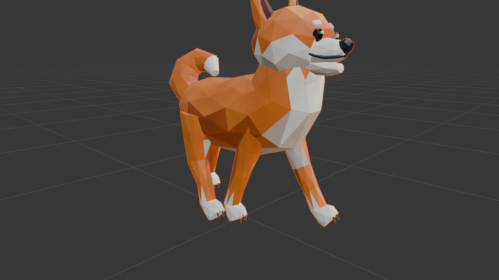
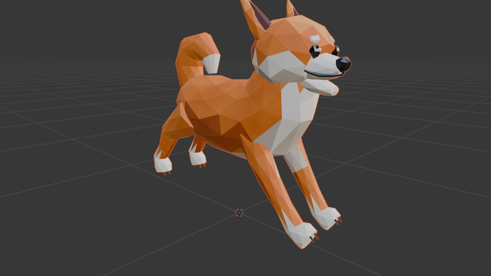
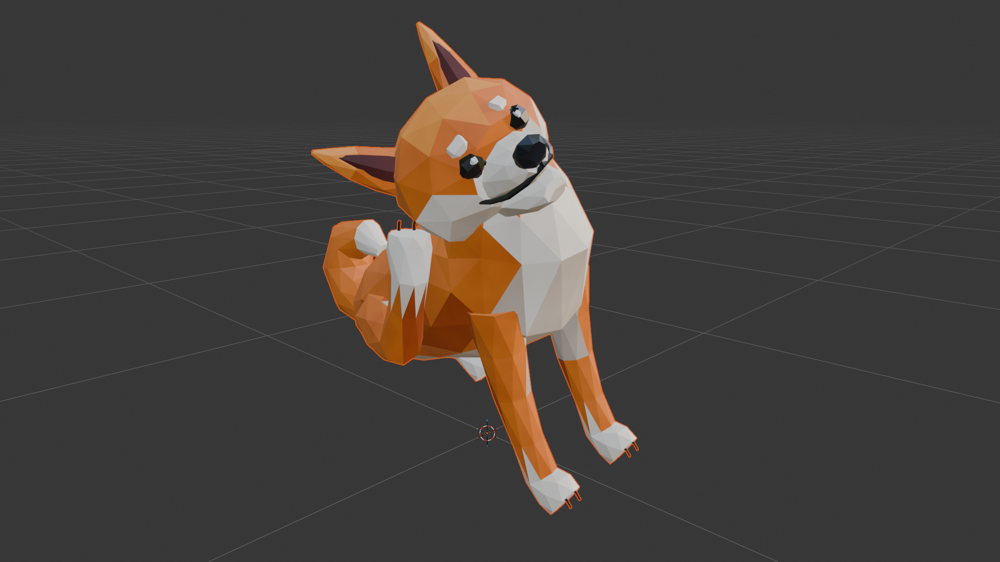
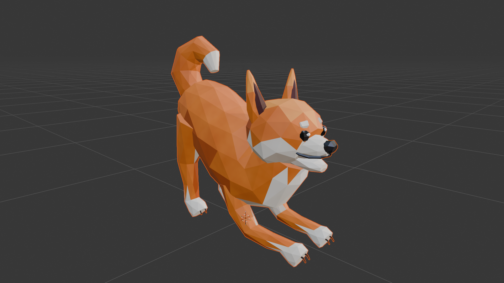
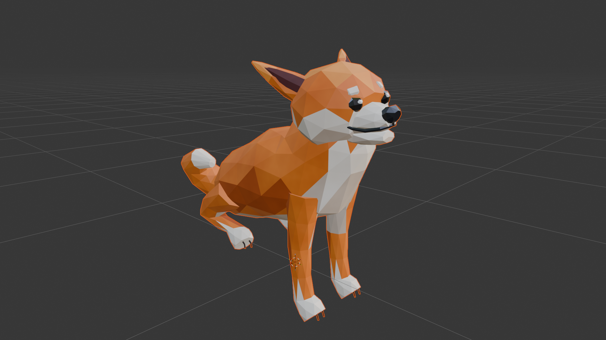
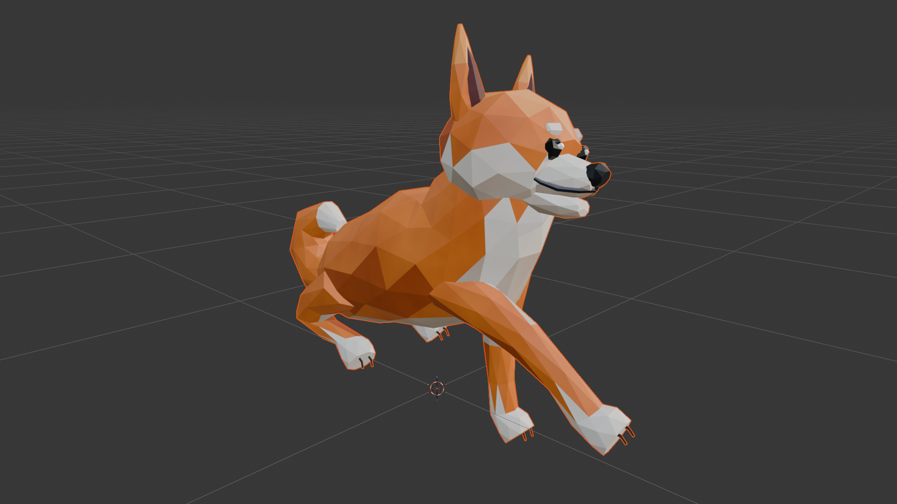
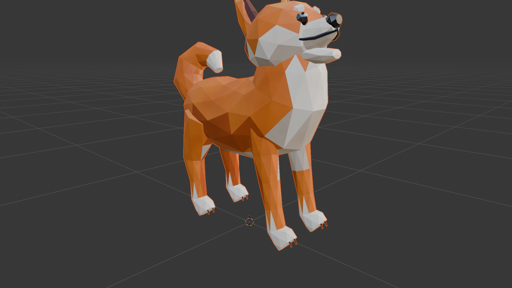

# Cozy Shiba Inu (`cozy_shiba_inu`) — 3D Character & Animation State Machine Guide

## 1. Overview & Art Direction
`cozy_shiba_inu` is an expressive, faceted low-poly ("origami/papercraft") **Shiba Inu companion** created in **Blender 5.2** (`24 FPS`, Scene-Linear sRGB color pipeline) for interactive gameplay in a **Cozy Power-Wash Game** (playing fetch, petting, trick training, reacting to water spray, and helping the player sniff out hidden dirt).

- **Mesh Object:** `Shiba_Mesh` (`1,094` vertices, `1,750` flat-shaded triangles/quads)
- **Armature Object:** `Shiba_Rig` (`34` bones — full quadruped locomotion skeleton + articulated facial rig: `Jaw`, `Tongue`, `Ear.L/R`, `Brow.L/R`, `Eyelid.L/R`, and 3-segment curled `Tail`)
- **Materials:** `11` procedural scene-linear PBR materials (`Mat_Shiba_Ginger`, `Mat_Shiba_AmberShadow`, `Mat_Shiba_GoldenLight`, `Mat_Shiba_CreamWhite`, `Mat_Shiba_CreamShadow`, `Mat_Shiba_EarInner`, `Mat_Shiba_NoseBlack`, `Mat_Shiba_EyeDark`, `Mat_Shiba_EyeSpec`, `Mat_Shiba_TonguePink`, `Mat_Shiba_PawPad`)
- **Exported Formats in `C:\3dassets\argon`:**
  - `cozy_shiba_inu.blend` (Master Blender 5.2 file with 15 Actions, NLA tracks, and 1-click Viewport playback UI)
  - `cozy_shiba_inu.glb` & `cozy_shiba_inu.gltf` + `.bin` (glTF 2.0 for Godot 4, Three.js, Unity, Unreal Engine 5)
  - `cozy_shiba_inu.fbx` (Autodesk FBX with baked skeletal actions & NLA strips)
  - `cozy_shiba_inu.usdc` (Universal Scene Description)
  - `cozy_shiba_inu.abc` (Alembic vertex cache)
  - `cozy_shiba_inu.obj` + `.mtl`, `cozy_shiba_inu.ply`, `cozy_shiba_inu.stl` (Static mesh formats)

---

## 2. Posture Groups (Why Posture Gating Matters!)

Every animation on `Shiba_Rig` belongs to a specific **Base Posture Group**.
> [!IMPORTANT]
> **Never transition directly between incompatible postures** (for example, `Run_Fetch_Gallop -> Scratch_Ear_Itch` or `Sleep_Curl_Nap -> Pickup_Drop_Ball`).
> - In `Run_Fetch_Gallop`, the dog is airborne/bounding horizontally on all fours at high speed (`Hips Z ≈ +0.46 m`, `rx ≈ +10°`).
> - In `Scratch_Ear_Itch`, the dog is **sitting on its rear haunches** (`Hips Z = +0.265 m`, `rx = -38°`) balancing on three legs while its right hind leg is raised to its ear.
> - Blending directly from `Run_Fetch_Gallop` into `Scratch_Ear_Itch` forces the pelvis to slam down to the floor while the right hind leg teleports from pushing off the ground behind the dog to scratching its ear in mid-stride!
>
> Instead, always route transitions through the **2 Core Hub States**:
> 1. **Standing Hub (`Idle_Stand_Pant`)** — Neutral 4-legged standing posture (`Hips` at rest height `Z = 0.44 m`).
> 2. **Sitting Hub (`Idle_Sit_Smile`)** — Neutral sitting posture (`Hips` lowered `Z = 0.265 m`, chest proud).

### Summary of the 4 Posture Groups

| Posture Group | Hub / Anchor State | Member Animations | Pelvis (`Hips`) State |
| :--- | :--- | :--- | :--- |
| **A. Sitting Group** | **`Idle_Sit_Smile` (Sitting Hub)** | `Idle_Sit_Smile`, `Pet_Head_Bliss`, `Give_Paw_Trick`, `Scratch_Ear_Itch` | Rear haunches on floor (`dz = -0.175 m`, `rx = -38°`), spine/chest upright |
| **B. Standing & Action Group** | **`Idle_Stand_Pant` (Standing Hub)** | `Idle_Stand_Pant`, `Speak_Double_Bark`, `Play_Bow_Excited`, `Pickup_Drop_Ball`, `Sniff_Find_Dirt`, `Play_Chomp_Spray`, `Shake_Off_Water` | All 4 paws on ground (`dz ≈ 0.0 m`, neutral spine) |
| **C. Locomotion Group** | **Driven by `speed` from `Idle_Stand_Pant`** | `Walk_Jaunty_Trot` (`speed = 0.5`), `Run_Fetch_Gallop` (`speed = 1.0`) | Dynamic gait bounce (`dz = +0.02 m` to `+0.06 m`) |
| **D. Ground / Lying Group** | **Entered from `Idle_Sit_Smile` or `Idle_Stand_Pant` at `speed = 0`** | `Belly_Rub_RollOver` (on back), `Sleep_Curl_Nap` (curled on belly) | Pelvis resting on floor (`dz = -0.27 m` or rolled `165°` on back) |

---

## 3. Complete Catalog of the 15 Animations (`24 FPS`)

| # | Action Name | Posture Group | Frames | Duration | Type | Entry Prerequisite | Exit Target | Description & Key Pose Details |
| :-: | :--- | :--- | :---: | :---: | :---: | :--- | :--- | :--- |
| **1** | `Idle_Sit_Smile` | **Sitting Hub** | `1–72` | `3.00s` | Loop | `speed == 0` | Any **Sitting** clip, or blend (`0.35s`) to `Idle_Stand_Pant` / `Sleep_Curl_Nap` | **Default Reference Pose.** Sitting politely with proud white chest, warm smile, soft tail wag, and curious left/right head tilts. |
| **2** | `Idle_Stand_Pant` | **Standing Hub** | `1–60` | `2.50s` | Loop | `speed == 0` | Any **Standing** clip, `Walk_Jaunty_Trot`, or blend (`0.35s`) to `Idle_Sit_Smile` | Standing on all fours, rhythmic happy panting (`Jaw` + `Tongue`), perky ears, and curled tail wagging. |
| **3** | `Pet_Head_Bliss` | Sitting | `1–60` | `2.50s` | Loop / Hold | Must be in `Idle_Sit_Smile` (`speed == 0`) | `Idle_Sit_Smile` (`0.25s`), or escalate to `Belly_Rub_RollOver` (`0.40s`) | Triggered when petted on the head. Leans head up into the player's hand, folds "airplane ears" flat back, squints eyes shut (`Eyelid.L/R`), and wags tail double-speed. |
| **4** | `Belly_Rub_RollOver` | Ground (Back) | `1–72` | `3.00s` | One-Shot | From `Pet_Head_Bliss` or `Idle_Stand_Pant` (`speed == 0`) | `Idle_Stand_Pant` or `Idle_Sit_Smile` (`0.35s`) | Rolls `165°` onto its back on the floor, tucks both front paws over its chest, lolls tongue out, and kicks its right hind leg rhythmically in bliss. |
| **5** | `Speak_Double_Bark` | Standing | `1–40` | `1.67s` | One-Shot | `Idle_Stand_Pant` or `Play_Bow_Excited` (`speed == 0`) | `Idle_Stand_Pant` or `Play_Bow_Excited` (`0.20s`) | Snappy `"Arf! Arf!"` double bark: anticipation crouch (`f8`), first chest-puff hop + jaw snap (`f12`), recoil (`f17`), second bigger bark (`f24`), and settle (`f40`). |
| **6** | `Give_Paw_Trick` | Sitting | `1–48` | `2.00s` | One-Shot | Must be in `Idle_Sit_Smile` (`speed == 0`) | `Idle_Sit_Smile` (`0.25s`) | Sits politely, tilts head happily, and raises its right front white-socked paw (`Leg_Front_Upper.R`) high forward with a gentle paw wave. |
| **7** | `Play_Bow_Excited` | Standing | `1–48` | `2.00s` | Loop / Hold | `Idle_Stand_Pant` (`speed == 0`, player holding ball/washer) | `Run_Fetch_Gallop` (`0.15s`), `Speak_Double_Bark` (`0.20s`), or `Idle_Stand_Pant` (`0.25s`) | **Fetch Ready Pose.** Drops front elbows and forearms flat to the ground (`Z = 0.02 m`) while keeping rear hips high in the air, bouncing and wagging rapidly. |
| **8** | `Pickup_Drop_Ball` | Standing | `1–36` | `1.50s` | One-Shot | Must decelerate to `Idle_Stand_Pant` (`speed == 0`) over ball | `Idle_Stand_Pant` (`0.20s`) -> then `Walk_Jaunty_Trot` / `Run_Fetch_Gallop` | Flexes front elbows (`f10`), opens jaw wide over the ground, clamps jaw onto the ball (`f15`), and lifts head proudly (`f25`) before returning to standing. |
| **9** | `Walk_Jaunty_Trot` | Locomotion | `1–24` | `1.00s` | Loop | Blend with `Idle_Stand_Pant` (`speed: 0.0 -> 0.5`) | `Idle_Stand_Pant` (`speed -> 0.0`, `0.20s`) or `Run_Fetch_Gallop` (`speed -> 1.0`, `0.20s`) | Bouncy diagonal 4-legged Shiba trot (`Front.L + Back.R` alternating with `Front.R + Back.L`) with natural wrist/hock flexion during leg lift. |
| **10** | `Run_Fetch_Gallop` | Locomotion | `1–18` | `0.75s` | Loop | From `Walk_Jaunty_Trot` (`speed: 0.5 -> 1.0`) or `Play_Bow_Excited` (launch!) | **Must decelerate through `Walk_Jaunty_Trot` -> `Idle_Stand_Pant`** (`0.25s`) | High-speed bounding gallop with full spine flexion/extension, ears pinned back in the wind, and clean mid-air suspension clearance. |
| **11** | `Play_Chomp_Spray` | Standing | `1–48` | `2.00s` | One-Shot | `Idle_Stand_Pant` or `Play_Bow_Excited` (when hit by gentle water mist) | `Shake_Off_Water` (`0.20s` chain) or `Idle_Stand_Pant` (`0.25s`) | Rears up playfully on its hind legs and snaps/chomps its jaw left and right (`3` big mid-air chomps) trying to catch the power-washer water spray. |
| **12** | `Shake_Off_Water` | Standing | `1–48` | `2.00s` | One-Shot | `Idle_Stand_Pant` or right after `Play_Chomp_Spray` (`speed == 0`) | `Idle_Stand_Pant` (`0.25s`) | Wide-stance crouch with a phase-delayed, high-frequency axial roll around the spine (`World Y`) rippling from `Head -> Neck -> Chest -> Hips -> Tail`. |
| **13** | `Scratch_Ear_Itch` | Sitting | `1–54` | `2.25s` | One-Shot | **Must be in `Idle_Sit_Smile` (`speed == 0`)** | `Idle_Sit_Smile` (`0.25s`) | Random idle quirk while sitting: tilts head and right ear down toward the right shoulder, squints `Eyelid.R`, and reaches `Leg_Back_Upper.R` forward & outward to rapidly scratch behind `Ear.R`. |
| **14** | `Sniff_Find_Dirt` | Standing | `1–60` | `2.50s` | One-Shot | `Idle_Stand_Pant` or `Walk_Jaunty_Trot` (after stopping at `speed == 0`) | `Idle_Stand_Pant` (`0.25s`) or `Speak_Double_Bark` (to alert player!) | First `65%` (`f1–39`): lowers nose to the floor sweeping left and right sniffing for dirt. Last `35%` (`f40–60`): perks ears up and raises front left paw (`Paw_Front.L`) pointing at the dirt spot! |
| **15** | `Sleep_Curl_Nap` | Ground (Belly) | `1–84` | `3.50s` | Loop | From `Idle_Sit_Smile` (`0.50s` settle) after long idle timeout (`> 20s`) | `Idle_Sit_Smile` (`0.45s` wake-up blend) | Lies flat on its belly (`Hips dz = -0.27 m`) with all 4 legs tucked naturally on the floor, head curled toward tail, eyes shut (`Eyelid.L/R`), slow breathing, and a cute ear twitch at `f31–37`. |

---

## 4. Animation State Machine & Transition Architecture

```mermaid
stateDiagram-v2
    direction TB

    %% Core Hubs
    state "Idle_Sit_Smile (SITTING HUB)" as SitHub
    state "Idle_Stand_Pant (STANDING HUB)" as StandHub

    %% Sitting Sub-states
    state "Sitting Interactions & Quirks" as SittingGroup {
        Pet_Head_Bliss
        Give_Paw_Trick
        Scratch_Ear_Itch
    }

    %% Ground / Lying Sub-states
    state "Ground / Lying States" as GroundGroup {
        Sleep_Curl_Nap
        Belly_Rub_RollOver
    }

    %% Locomotion Blend Tree
    state "Locomotion 1D Blend Space (speed: 0.0 -> 1.0)" as LocoGroup {
        Walk_Jaunty_Trot
        Run_Fetch_Gallop
    }

    %% Standing Interactions
    state "Standing Actions & Power-Wash Reactions" as StandingGroup {
        Play_Bow_Excited
        Speak_Double_Bark
        Pickup_Drop_Ball
        Sniff_Find_Dirt
        Play_Chomp_Spray
        Shake_Off_Water
    }

    %% Hub-to-Hub transitions
    [*] --> SitHub
    SitHub <--> StandHub : Sit / Stand Transition (0.35s, speed == 0)

    %% Sitting Transitions
    SitHub --> Pet_Head_Bliss : Player Pets Head (0.25s)
    Pet_Head_Bliss --> SitHub : Stop Petting (0.25s)
    Pet_Head_Bliss --> Belly_Rub_RollOver : Pet > 3s (0.40s)
    Belly_Rub_RollOver --> SitHub : Clip Ends (0.35s)

    SitHub --> Give_Paw_Trick : "Give Paw" Prompt (0.25s)
    Give_Paw_Trick --> SitHub : Clip Ends (0.25s)

    SitHub --> Scratch_Ear_Itch : Random Sitting Quirk (0.25s)
    Scratch_Ear_Itch --> SitHub : Clip Ends (0.25s)

    SitHub --> Sleep_Curl_Nap : Idle Timeout > 20s (0.50s)
    Sleep_Curl_Nap --> SitHub : Player Approaches / Wake Up (0.45s)

    %% Locomotion Transitions (ONLY via StandHub or Play_Bow!)
    StandHub --> Walk_Jaunty_Trot : speed > 0.1 (0.20s)
    Walk_Jaunty_Trot --> StandHub : speed == 0.0 (0.20s)
    Walk_Jaunty_Trot --> Run_Fetch_Gallop : speed > 0.65 (0.20s)
    Run_Fetch_Gallop --> Walk_Jaunty_Trot : speed < 0.65 (0.20s)

    %% Standing Action Transitions
    StandHub --> Play_Bow_Excited : Player Holds Ball (0.25s)
    Play_Bow_Excited --> Run_Fetch_Gallop : Ball Thrown! (0.15s Launch)
    Play_Bow_Excited --> Speak_Double_Bark : Impatient Bark (0.20s)
    Play_Bow_Excited --> StandHub : Cancel Fetch (0.25s)

    StandHub --> Pickup_Drop_Ball : At Ball / Player Feet (0.20s, speed == 0)
    Pickup_Drop_Ball --> StandHub : Clip Ends (0.20s)

    StandHub --> Speak_Double_Bark : Call Dog / Alert (0.20s)
    Speak_Double_Bark --> StandHub : Clip Ends (0.20s)

    StandHub --> Sniff_Find_Dirt : Inspect Dirt Command (0.25s, speed == 0)
    Sniff_Find_Dirt --> Speak_Double_Bark : Dirt Found! Bark Alert (0.20s)
    Sniff_Find_Dirt --> StandHub : Clip Ends (0.25s)

    StandHub --> Play_Chomp_Spray : Hit by Water Spray (0.20s)
    Play_Chomp_Spray --> Shake_Off_Water : Wetness > 0 -> Dry Off! (0.20s)
    Shake_Off_Water --> StandHub : Clip Ends (0.25s)
```

---

## 5. Multi-Step Gameplay Sequence Recipes

To make the Shiba Inu feel like a believable living creature in your game engine (Godot, Unity, Unreal), use these multi-step transition chains for core gameplay loops:

### 5.1 Playing Fetch (`Throw -> Chase -> Grab -> Return -> Drop`)
1. **Ready Stance:** `Idle_Stand_Pant` $\xrightarrow{0.25\text{s}}$ `Play_Bow_Excited` (while the player aims the ball; optionally trigger `Speak_Double_Bark` if the player holds the ball for more than 4 seconds).
2. **Launch & Chase:** `Play_Bow_Excited` $\xrightarrow{0.15\text{s}}$ `Run_Fetch_Gallop` (as soon as the ball is thrown—the low front chest of `Play_Bow_Excited` springs naturally into frame 1 of `Run_Fetch_Gallop`!).
3. **Approach & Stop at Ball:** `Run_Fetch_Gallop` $\xrightarrow{0.20\text{s}}$ `Walk_Jaunty_Trot` $\xrightarrow{0.20\text{s}}$ `Idle_Stand_Pant` (decelerate over the last `1.5 m` before reaching the ball).
4. **Pick Up Ball:** `Idle_Stand_Pant` $\xrightarrow{0.20\text{s}}$ `Pickup_Drop_Ball` (attach the ball mesh to the `Jaw` or `Snout` socket at **Frame 15** when the jaw clamps shut).
5. **Return to Player:** `Pickup_Drop_Ball` $\xrightarrow{0.20\text{s}}$ `Idle_Stand_Pant` $\xrightarrow{0.20\text{s}}$ `Walk_Jaunty_Trot` (or `Run_Fetch_Gallop`) back to the player's feet, then decelerate to `Idle_Stand_Pant`.
6. **Drop Ball & Sit Proudly:** `Idle_Stand_Pant` $\xrightarrow{0.20\text{s}}$ `Pickup_Drop_Ball` (detach the ball at **Frame 10** when the jaw opens wide) $\xrightarrow{0.20\text{s}}$ `Idle_Stand_Pant` $\xrightarrow{0.35\text{s}}$ `Idle_Sit_Smile`.

### 5.2 What If You Want the Dog to Scratch Its Ear After Running?
Never go `Run_Fetch_Gallop -> Scratch_Ear_Itch`. Always chain through the deceleration and sitting hubs:
$$\text{Run\_Fetch\_Gallop} \xrightarrow{0.20\text{s}} \text{Walk\_Jaunty\_Trot} \xrightarrow{0.20\text{s}} \text{Idle\_Stand\_Pant} \xrightarrow{0.35\text{s}} \text{Idle\_Sit\_Smile} \xrightarrow{0.25\text{s}} \text{Scratch\_Ear\_Itch}$$

### 5.3 Petting & Belly Rub Progression
1. If the dog is standing (`Idle_Stand_Pant`), first transition to `Idle_Sit_Smile` (`0.35s`) when the player presses **Interact / Pet**.
2. Transition `Idle_Sit_Smile` $\xrightarrow{0.25\text{s}}$ `Pet_Head_Bliss` while the player's hand strokes the head.
3. If the player continues petting for `> 3.0 seconds`, reward them by transitioning `Pet_Head_Bliss` $\xrightarrow{0.40\text{s}}$ `Belly_Rub_RollOver`.
4. When `Belly_Rub_RollOver` finishes (`f72`), blend back to `Idle_Sit_Smile` (`0.35s`).

### 5.4 Power-Washer Spray Reaction (`Spray -> Chomp -> Shake Dry`)
1. When the player's water stream lightly hits the Shiba Inu while standing:
   - Transition `Idle_Stand_Pant` $\xrightarrow{0.20\text{s}}$ `Play_Chomp_Spray` (the dog rears up and snaps playfully at the water mist).
2. As soon as the spray stops (or `Play_Chomp_Spray` reaches `f48`):
   - Automatically chain `Play_Chomp_Spray` $\xrightarrow{0.20\text{s}}$ `Shake_Off_Water` (spawn water droplet particles from `Chest` and `Head` between **Frames 10 and 38**!).
3. Return `Shake_Off_Water` $\xrightarrow{0.25\text{s}}$ `Idle_Stand_Pant`.

### 5.5 Sniffing Out Remaining Dirt (`Cozy Helper Mechanic`)
1. When the player activates the **"Find Dirt" helper** (or the dog walks near a hidden dirty object):
   - Walk/trot to the dirt location (`Walk_Jaunty_Trot`), stop at `Idle_Stand_Pant` (`0.20s`), and play `Sniff_Find_Dirt` (`0.25s`).
2. During `Sniff_Find_Dirt`:
   - **Frames 1–39:** Nose sweeps left and right along the ground.
   - **Frames 40–60:** Dog perks up and points with its front left paw raised (`Paw_Front.L`).
3. Chain `Sniff_Find_Dirt` $\xrightarrow{0.20\text{s}}$ `Speak_Double_Bark` (`"Arf! Arf!"`) to alert the player where the last spot of dirt is!

---

## 6. Explicit Forbidden Transitions (Anti-Patterns to Block in Code)

| Forbidden Transition | Why It Breaks Visually | Correct Transition Path |
| :--- | :--- | :--- |
| `Run_Fetch_Gallop -> Scratch_Ear_Itch` | Teleports from airborne 4-legged horizontal gallop directly into a 3-legged sitting pose with hind paw at ear. | `Run_Fetch_Gallop -> Walk_Jaunty_Trot -> Idle_Stand_Pant -> Idle_Sit_Smile -> Scratch_Ear_Itch` |
| `Run_Fetch_Gallop -> Give_Paw_Trick` | Same sitting vs. galloping pelvis mismatch; dog's front right leg lifts while still moving forward. | `Run_Fetch_Gallop -> Walk_Jaunty_Trot -> Idle_Stand_Pant -> Idle_Sit_Smile -> Give_Paw_Trick` |
| `Run_Fetch_Gallop -> Pickup_Drop_Ball` | Dog's face dives into the ground at full gallop speed causing foot sliding. | `Run_Fetch_Gallop -> Walk_Jaunty_Trot -> Idle_Stand_Pant -> Pickup_Drop_Ball` |
| `Walk_Jaunty_Trot / Run -> Sleep_Curl_Nap` | Dog collapses flat onto its belly (`Z = -0.27 m`) mid-stride. | `Walk_Jaunty_Trot -> Idle_Stand_Pant -> Idle_Sit_Smile -> Sleep_Curl_Nap` |
| `Sleep_Curl_Nap -> Run_Fetch_Gallop` | Launches from sleeping on belly with eyes closed straight into full sprint. | `Sleep_Curl_Nap -> Idle_Sit_Smile -> Idle_Stand_Pant -> Walk_Jaunty_Trot -> Run_Fetch_Gallop` |
| `Scratch_Ear_Itch -> Shake_Off_Water` | Mixing a 3-legged sitting ear scratch with a 4-legged standing axial spine twist. | `Scratch_Ear_Itch -> Idle_Sit_Smile -> Idle_Stand_Pant -> Shake_Off_Water` |
| `Belly_Rub_RollOver -> Walk_Jaunty_Trot` | Starts trotting while still upside-down (`165°` roll) if interrupted early. | Wait for `Belly_Rub_RollOver` to reach `f64–72` (unrolled), then `-> Idle_Stand_Pant -> Walk_Jaunty_Trot` |

---

## 7. Recommended Crossfade / Blend Durations & Bone Masks

| Transition Type | Recommended Crossfade Duration | Notes |
| :--- | :---: | :--- |
| `Idle_Stand_Pant <-> Walk_Jaunty_Trot <-> Run_Fetch_Gallop` | **`0.18s – 0.22s`** (`4–5 frames`) | Use a 1D Blend Space driven by normalized `speed` (`0.0 = Stand`, `0.45 = Walk`, `1.0 = Run`). |
| `Play_Bow_Excited -> Run_Fetch_Gallop` | **`0.12s – 0.15s`** (`3–4 frames`) | Fast, snappy launch into the fetch sprint when the ball is thrown. |
| `Idle_Sit_Smile <-> Idle_Stand_Pant` | **`0.35s`** (`8 frames`) | Smoothly lowers/raises `Hips` and folds/unfolds the hind legs (`Leg_Back_Upper/Lower`). |
| `Idle_Sit_Smile <-> Sitting Clips` (`Pet`, `Give_Paw`, `Scratch_Ear`) | **`0.25s`** (`6 frames`) | All share the exact same `apply_sit_base_pose()` foundation, so the pelvis and planted legs stay rock-solid! |
| `Idle_Stand_Pant <-> Standing Clips` (`Bark`, `Pickup`, `Sniff`, `Shake`, `Chomp`) | **`0.20s – 0.25s`** (`5–6 frames`) | All start and end in the neutral standing pose (`reset_pose()`). |
| `Idle_Sit_Smile <-> Sleep_Curl_Nap` | **`0.45s – 0.50s`** (`11–12 frames`) | Slow, cozy settle down into a nap or drowsy wake-up. |

### Optional Upper-Body / Facial Additive Blending
Because the facial bones (`Head`, `Jaw`, `Tongue`, `Ear.L/R`, `Brow.L/R`, `Eyelid.L/R`) and `Tail_Base/Mid/Tip` are cleanly separated from the leg chains:
- You can play **`Speak_Double_Bark`** on an **Upper-Body / Head Bone Mask** (`Neck`, `Head`, `Jaw`, `Tongue`, `Ear.L/R`, `Brow.L/R`) while the dog is sitting (`Idle_Sit_Smile`) or trotting (`Walk_Jaunty_Trot`) so the Shiba can bark while sitting or trotting without overriding its leg posture!

---

## 8. Visual Preview Gallery

| `Idle_Sit_Smile` (Sitting Hub) | `Walk_Jaunty_Trot` (Locomotion) | `Run_Fetch_Gallop` (Locomotion) | `Scratch_Ear_Itch` (Sitting Quirk) |
| :---: | :---: | :---: | :---: |
|  |  |  |  |

| `Play_Bow_Excited` (Fetch Ready) | `Pet_Head_Bliss` (Head Petting) | `Give_Paw_Trick` (Paw Trick) | `Speak_Double_Bark` (Barking) |
| :---: | :---: | :---: | :---: |
|  |  |  |  |
