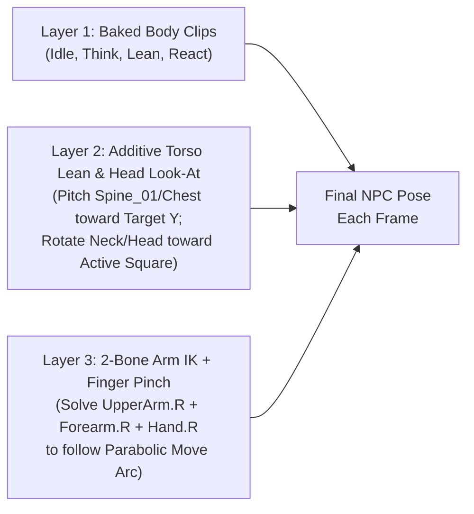
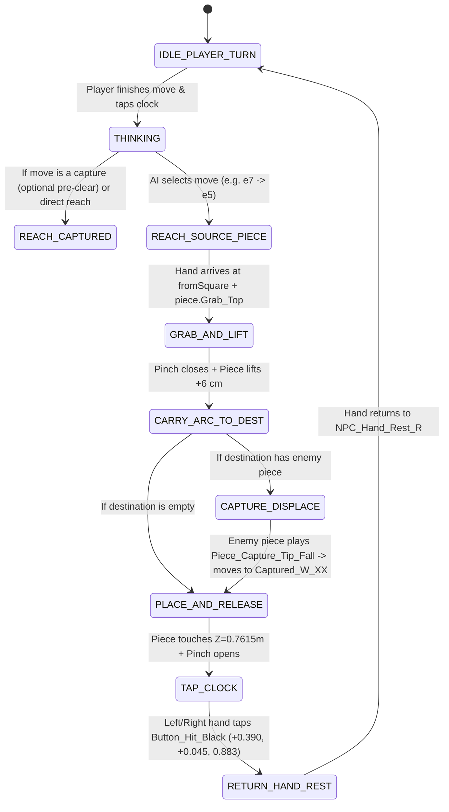

# Chess NPC Opponent — Rigging, Animation & Runtime IK Integration Guide

This guide specifies how to rig, skin, animate, and drive a seated **Chess Opponent NPC** (humanoid, robot, or anthropomorphic character) so it seamlessly plays against a live player at the [`cozy_chess_marble_table.glb`](file:///C:/argon/chess_table/cozy_chess_marble_table.glb) and [`cozy_chess_round_chair.glb`](file:///C:/argon/chess_table/cozy_chess_round_chair.glb) station.

---

## 1. Spatial Calibration & Seated Proportions

All coordinates below are in **Station World Space** (where the center of the pedestal table base is `(0.0, 0.0, 0.0)`, White plays from `-Y`, and the **NPC plays Black from `+Y` facing `-Y`**):

| Landmark / Socket | Station World `(X, Y, Z)` | Purpose |
| :--- | :--- | :--- |
| **Table Center (`Root`)** | `(0.000, 0.000, 0.000)` | Center of the pedestal base on the ground (`Z = 0`). |
| **Board Playing Surface** | `Z = 0.7615 m` | Top of the `64` veined marble squares (`Square_a1`..`Square_h8`). |
| **Nearest Rank to NPC (`Rank 8`, `a8..h8`)** | `Y = +0.2275 m`, `Z = 0.7615 m` | Closest row of pieces to the NPC (`44.8 cm` in front of NPC spine). |
| **Center of Board** | `(0.000, 0.000, 0.7615)` | `67.5 cm` in front of the NPC chair center. |
| **Farthest Rank from NPC (`Rank 1`, `a1..h1`)** | `Y = -0.2275 m`, `Z = 0.7615 m` | Farthest row the NPC may ever reach (`90.2 cm` from chair center; require torso lean `+18°..+25°`). |
| **NPC Chair Center (`Chair_Black_Spot`)** | `(0.000, +0.675, 0.000)` | Floor position of the NPC's round marble drum chair. |
| **NPC Hip / Pelvis Socket (`Seat_Attach_Point`)** | `(0.000, +0.675, 0.482)` | Top center of the tufted leather cushion (`Z = 0.482 m`, compresses to `0.464 m` when seated). |
| **NPC Foot Rests (`Foot_Rest_L` / `Foot_Rest_R`)** | `(±0.160, +0.515, 0.000)` | Where the NPC's heels/shoes plant on the ground in front of the drum chair. |
| **NPC Hand Rests (`NPC_Hand_Rest_L` / `R`)** | `(±0.150, +0.555, 0.765)` | Resting position for the NPC's hands on the front rim of the marble table or lap between turns. |
| **Analog Clock (`Clock_Spot`)** | `(+0.335, 0.000, 0.7615)` | Right side of the table (from White's view) / Left side of the table (from Black NPC's view). |
| **NPC Clock Button (`Button_Hit_Black`)** | `(+0.390, +0.045, 0.883)` | Top of the Black turn button the NPC taps after completing a move. |
| **Captured White Tray (`Captured_W_01..16`)** | `X = -0.382..-0.322`, `Y = -0.2275..+0.2275`, `Z = 0.7615` | Side border where the NPC deposits captured White pieces. |

### Recommended NPC Arm & Torso Proportions
To reach `Rank 1` (`Y = -0.2275 m`) comfortably without hyper-extending the elbow:
- **Seated Shoulder Height (`Shoulder.R` / `L`):** `Z ≈ 0.96 – 1.04 m` (about `20–28 cm` above the `0.7615 m` tabletop).
- **Upper Arm Length (`UpperArm`):** `0.27 – 0.30 m`
- **Forearm Length (`Forearm`):** `0.25 – 0.28 m`
- **Hand + Pinch Tip Offset (`Hand` $\rightarrow$ `Pinch_Tip`):** `0.10 – 0.12 m`
- **Total Arm Reach (`0.62 – 0.70 m`) + Forward Chest Lean (`+0.22 m` at `22°` pitch):** Gives `0.84 – 0.92 m` horizontal reach from the chair center, effortlessly covering every square from `a8` to `h1`.

---

## 2. Mandatory NPC Bone Hierarchy (`NPC_Rig`)

Whether building the NPC in Blender via BMesh/Python (`C:/argon/AGENTS.md`) or importing a character, structure the armature (`NPC_Rig`) with the following hierarchy and exact naming so the runtime controller can drive both **Head Look-At** and **Right-Arm 2-Bone IK**:

```text
Root                              (0.000, +0.675, 0.000) -> (0.000, +0.675, 0.200)  [use_connect=False]
 └── Hips                         (0.000, +0.675, 0.470) -> (0.000, +0.675, 0.580)  [use_connect=False]
      ├── Spine_01                (0.000, +0.675, 0.580) -> (0.000, +0.675, 0.740)  [use_connect=True]
      │    └── Chest              (0.000, +0.675, 0.740) -> (0.000, +0.675, 0.940)  [use_connect=True]
      │         ├── Neck          (0.000, +0.675, 0.940) -> (0.000, +0.675, 1.030)  [use_connect=True]
      │         │    └── Head     (0.000, +0.675, 1.030) -> (0.000, +0.600, 1.180)  [use_connect=True]
      │         │         ├── Jaw (0.000, +0.630, 1.050) -> (0.000, +0.570, 1.020)  [use_connect=False]
      │         │         ├── Eye.L / Eye.R                                         [use_connect=False]
      │         │
      │         ├── Clavicle.R    (-0.040, +0.675, 0.920) -> (-0.160, +0.665, 0.920) [Right side in world -X because NPC faces -Y]
      │         │    └── UpperArm.R (-0.160, +0.665, 0.920) -> (-0.180, +0.560, 0.700)
      │         │         └── Forearm.R (-0.180, +0.560, 0.700) -> (-0.150, +0.420, 0.765)
      │         │              └── Hand.R (-0.150, +0.420, 0.765) -> (-0.150, +0.340, 0.750)
      │         │                   ├── Thumb_01.R -> Thumb_02.R
      │         │                   ├── Index_01.R -> Index_02.R
      │         │                   ├── Middle_01.R -> Middle_02.R
      │         │                   └── Pinch_Socket.R  (Tip between Thumb & Index where Piece `Grab_Top` snaps)
      │         │
      │         └── Clavicle.L    (+0.040, +0.675, 0.920) -> (+0.160, +0.665, 0.920) [Left side in world +X]
      │              └── UpperArm.L -> Forearm.L -> Hand.L -> (Thumb/Index/Pinch_Socket.L)
      │
      ├── UpperLeg.R              (-0.120, +0.675, 0.470) -> (-0.140, +0.450, 0.440) [Seated horizontal thigh]
      │    └── LowerLeg.R         (-0.140, +0.450, 0.440) -> (-0.140, +0.480, 0.060) [Seated vertical shin]
      │         └── Foot.R        (-0.140, +0.480, 0.060) -> (-0.140, +0.360, 0.000) [Planted on floor Z=0]
      └── UpperLeg.L              (+0.120, +0.675, 0.470) -> (+0.140, +0.450, 0.440)
           └── LowerLeg.L         (+0.140, +0.450, 0.440) -> (+0.140, +0.480, 0.060)
                └── Foot.L        (+0.140, +0.480, 0.060) -> (+0.140, +0.360, 0.000)

  # Optional IK Control Bones (Children of Root, use_connect=False)
  ├── IK_Hand_Target.R            (-0.150, +0.340, 0.750)
  ├── IK_Elbow_Pole.R             (-0.350, +0.650, 0.780)
  ├── IK_Hand_Target.L            (+0.150, +0.340, 0.750)
  └── LookAt_Target               ( 0.000,  0.000, 0.762)
```

> [!IMPORTANT]
> **Build in Seated Rest Pose or Provide a `Seated_Base` Pose:**
> If the NPC is exclusively used at the chess table, building the rig with `Hips` at `Z = 0.47 m`, thighs pitched forward `85°`, and shins vertical (`Foot.L/R` at `Z = 0.000 m`) eliminates hip/knee skin-pinching and makes all seated animations simpler. If using a general standing NPC rig, create a 1-frame `Seated_Pose_Base` clip that bends `Hips`, `UpperLeg.L/R`, and `LowerLeg.L/R` onto `Seat_Attach_Point` (`Z = 0.482 m`).

---

## 3. Why You Should Use Hybrid Animation + Runtime IK (Not 4,096 Baked Moves)

A chessboard has `64` origin squares and `64` destination squares (`4,096` combinations), plus `6` piece heights (`Pawn` `6.8 cm` up to `King` `13.5 cm`). Baking separate animations for every square pair is impractical.

Instead, use a **3-Layer Hybrid Architecture**:



1. **Layer 1 — Baked Full-Body Clips (`8` lightweight animations in the `.glb`/`.fbx`):**
   Handles breathing, chin-stroking while thinking, posture shifts, finger pinch/release poses, and emotional reactions (check, capture, victory, defeat).
2. **Layer 2 — Procedural Torso Pitch & Head/Eye Look-At:**
   - **Head/Neck Look-At:** Slerps `Neck` (`35%`) and `Head` (`65%`) toward a `lookTarget` (`Vector3`) that alternates between the center of the board, the player's eyes (`(0, -0.675, 1.15)`), and the currently moving chess piece.
   - **Spine Reach Compensation:** When the NPC's hand target moves toward the player's side of the board (`target.y < +0.15`), add a proportional forward pitch to `Spine_01` and `Chest`:
     $$\text{spinePitchRad} = \text{clamp}\left(\frac{0.25 - \text{target.y}}{0.55}, 0.0, 1.0\right) \times 0.38\text{ rad } (22^\circ)$$
3. **Layer 3 — Analytic 2-Bone Right-Arm IK (`UpperArm.R` $\rightarrow$ `Forearm.R` $\rightarrow$ `Hand.R`):**
   Drives `Pinch_Socket.R` along the exact 3D parabolic trajectory from the hand rest $\rightarrow$ source piece `Grab_Top` $\rightarrow$ destination square `Grab_Top` $\rightarrow$ `Button_Hit_Black` $\rightarrow$ hand rest.

---

## 4. The 8 Required Baked NPC Animation Clips

Bake these `8` clips onto `NPC_Rig` (with `arm_data.pose_position = 'POSE'`, `bake_anim_use_all_actions=True`, `bake_anim_use_nla_strips=False`):

| # | Clip Name | Frames (`24 fps`) | Loop? | Description & Keyed Bones |
| :--- | :--- | :--- | :--- | :--- |
| 1 | `NPC_Seated_Idle_Breathe` | `1 – 72` (`3.0s`) | Yes | Calm seated posture, hands resting at `NPC_Hand_Rest_L/R`, gentle chest breathing (`±1.5°`), subtle head scan across the board, feet planted at `Z = 0.000 m`. |
| 2 | `NPC_Seated_Think_Chin_Stroke` | `1 – 96` (`4.0s`) | Yes | Left elbow rests on table edge; right hand rises to stroke chin/jaw while head tilts `-8°` thoughtfully and eyes scan ranks `3–6`. Played while the AI engine computes its move. |
| 3 | `NPC_Seated_Board_Scan` | `1 – 80` (`3.3s`) | Yes | NPC leans slightly forward (`Spine_01` `+10°`), hands clasped or on table rim, head sweeps left-to-right (`a`-file to `h`-file) evaluating threats. |
| 4 | `NPC_Arm_Reach_Neutral` | `1 – 40` (`1.6s`) | Pose | Neutral reaching posture with right fingers open in a pre-pinch shape (`Thumb_01/02.R` and `Index_01/02.R` parted by `3.5 cm`), ready for runtime 2-bone IK override. |
| 5 | `NPC_Hand_Pinch_Close` | `1 – 15` (`0.6s`) | Clamp | Closes `Thumb`, `Index`, and `Middle` fingers onto `Pinch_Socket.R` (`1.8 cm` gap matching the neck below every Staunton piece's finial/crown) and tilts wrist `-10°` as if lifting `80g` of marble. |
| 6 | `NPC_Hand_Pinch_Open` | `1 – 15` (`0.6s`) | Clamp | Smoothly opens `Thumb`, `Index`, and `Middle` fingers by `3.5 cm` as the piece settles onto the target square. |
| 7 | `NPC_React_Check_Surprise` | `1 – 48` (`2.0s`) | No | Quick torso recoil (`Spine_01` `-8°`), eyebrows/head lift, brief hand lift when the player puts the NPC's King in check or captures a major piece. |
| 8 | `NPC_React_Game_End_Clap` | `1 – 72` (`3.0s`) | No | Polite seated applause / nod of respect across the table (works for both victory and sportsmanlike defeat). |

---

## 5. Complete Turn Execution Timeline (State Machine)

When it becomes the NPC's turn (`turn === 'b'`), run this 8-phase state machine so the NPC, the chess pieces, the captured tray, and the analog clock move as one cohesive physical performance:



### Exact Phase Timings & Trajectories

Let:
- $P_{\text{rest}} = (-0.150, +0.555, 0.765)$ (NPC right hand rest in Station World Space)
- $P_{\text{from}} = \text{Square}(f_1, r_1) + (0, 0, h_{\text{grab}})$ where $h_{\text{grab}}$ is the piece's `Grab_Top.z` (`0.056 m` for Pawn up to `0.115 m` for King)
- $P_{\text{to}} = \text{Square}(f_2, r_2) + (0, 0, h_{\text{grab}})$
- $P_{\text{clock}} = (+0.390, +0.045, 0.883)$ (`Button_Hit_Black` on [`cozy_chess_clock_analog.glb`](file:///C:/argon/chess_table/cozy_chess_clock_analog.glb))
- Smoothstep easing: $s(t) = t^2 (3 - 2t)$ for $t \in [0, 1]$

| Phase | Duration | Hand IK Target Trajectory $\mathbf{H}(t)$ | Piece Transform & Animation | NPC Body / Head / Clock Action |
| :--- | :--- | :--- | :--- | :--- |
| **1. `THINKING`** | `1.2 – 2.8 s` | Stays at $P_{\text{rest}}$ (or driven by `NPC_Seated_Think_Chin_Stroke`). | All pieces stationary on board. | Play `NPC_Seated_Think_Chin_Stroke` + Chair plays `Chair_NPC_Swivel_Think`. Head scans between $P_{\text{from}}$ and $P_{\text{to}}$. |
| **2. `REACH_SOURCE`** | `0.55 s` | $\text{lerp}(P_{\text{rest}}, P_{\text{from}}, s(t)) + (0, 0, 0.04 \sin(\pi t))$ | Piece stationary at $\text{Square}(f_1, r_1)$. | Crossfade to `NPC_Arm_Reach_Neutral`. Spine pitches forward proportionally to $P_{\text{from}}.y$. Head looks at $P_{\text{from}}$. |
| **3. `GRAB_PINCH`** | `0.18 s` | Locked at $P_{\text{from}}$. | Piece begins `Piece_Lift_Hop` (`Body_Tilt` pitches `-8°`). | Play `NPC_Hand_Pinch_Close` so thumb & index close around the piece's neck (`Grab_Top`). |
| **4. `CARRY_ARC`** | `0.65 s` (`0.80 s` for Knight hops) | $\text{lerp}(P_{\text{from}}, P_{\text{to}}, s(t)) + (0, 0, h_{\text{arc}} \sin(\pi t))$ where $h_{\text{arc}} = 0.065\text{ m}$ (`0.095\text{ m}` for Knights jumping over pieces). | Piece base follows $\mathbf{H}(t) - (0, 0, h_{\text{grab}})$ with a subtle pendulum tilt along velocity vector. | Head tracks $\mathbf{H}(t)$. If target square has a White piece, trigger `Piece_Capture_Tip_Fall` on the White piece at $t = 0.65$, then snap it to `Captured_W_XX`. |
| **5. `PLACE_RELEASE`** | `0.22 s` | Settles at $P_{\text{to}}$, then lifts `+0.025 m` as fingers open. | Piece base snaps cleanly to $\text{Square}(f_2, r_2)$ (`Z = 0.7615 m`), `Body_Tilt` settles `0°`. | Play `NPC_Hand_Pinch_Open` + trigger subtle marble *clack* audio (`elevenlabs-sfx`). |
| **6. `TAP_CLOCK`** | `0.45 s` | $\text{lerp}(P_{\text{to}}, P_{\text{clock}}, s(t)) + (0, 0, 0.05 \sin(\pi t))$ | Moved piece stays on $\text{Square}(f_2, r_2)$. | At $t = 0.85..1.0$, play `Clock_Button_Toggle` on `cozy_chess_clock_analog` and switch ticking animation from `Clock_Black_Turn_Tick` to `Clock_White_Turn_Tick`. |
| **7. `RETURN_REST`** | `0.55 s` | $\text{lerp}(P_{\text{clock}}, P_{\text{rest}}, s(t)) + (0, 0, 0.03 \sin(\pi t))$ | — | Spine pitch returns to `0°`, head looks up at the Player (`(0, -0.675, 1.15)`), crossfade back to `NPC_Seated_Idle_Breathe`. |

---

## 6. Drop-In TypeScript / Three.js Controller (`ChessNpcController`)

Below is the self-contained TypeScript helper you can drop directly into `C:/claude/vrcozy/src/pw/world/chess-lawn.ts` to drive any Three.js `Object3D` / `SkinnedMesh` NPC and solve 2-bone analytic IK + Spine Lean + Head Look-At every frame:

```typescript
import * as THREE from 'three';

export interface ChessMoveSpec {
  fromSquare: string;       // e.g. 'e7'
  toSquare: string;         // e.g. 'e5'
  pieceMesh: THREE.Object3D;
  pieceGrabHeight: number;  // e.g. 0.056 for pawn, 0.115 for king
  isKnight?: boolean;
  capturedPieceMesh?: THREE.Object3D;
  capturedSlotIndex?: number; // 0..15 -> Captured_W_01..16
}

export class ChessNpcController {
  private stationRoot: THREE.Object3D;
  private npcRoot: THREE.Object3D;

  // Resolved NPC Bones
  private spineBone?: THREE.Bone;
  private chestBone?: THREE.Bone;
  private neckBone?: THREE.Bone;
  private headBone?: THREE.Bone;
  private upperArmR?: THREE.Bone;
  private forearmR?: THREE.Bone;
  private handR?: THREE.Bone;

  // Station World Constants (relative to stationRoot)
  private readonly BOARD_Z = 0.7615;
  private readonly SQUARE_SIZE = 0.065;
  private readonly HAND_REST_R = new THREE.Vector3(-0.150, 0.555, 0.765);
  private readonly CLOCK_BTN_BLACK = new THREE.Vector3(0.390, 0.045, 0.883);
  private readonly PLAYER_EYES = new THREE.Vector3(0.0, -0.675, 1.150);

  // Current IK & Look-At state in station space
  public handTargetLocal = this.HAND_REST_R.clone();
  public lookTargetLocal = new THREE.Vector3(0, 0, this.BOARD_Z);

  constructor(stationRoot: THREE.Object3D, npcRoot: THREE.Object3D) {
    this.stationRoot = stationRoot;
    this.npcRoot = npcRoot;

    // Seat NPC on Chair_Black_Spot cushion
    this.npcRoot.position.set(0.0, 0.675, 0.482);
    this.npcRoot.rotation.set(0, Math.PI, 0); // Face -Y (toward White player)
    this.stationRoot.add(this.npcRoot);

    this.npcRoot.traverse((obj) => {
      if (obj instanceof THREE.Bone) {
        if (obj.name === 'Spine_01' || obj.name === 'Spine') this.spineBone = obj;
        if (obj.name === 'Chest') this.chestBone = obj;
        if (obj.name === 'Neck' || obj.name === 'Neck_01') this.neckBone = obj;
        if (obj.name === 'Head') this.headBone = obj;
        if (obj.name === 'UpperArm.R' || obj.name === 'UpperArm_R') this.upperArmR = obj;
        if (obj.name === 'Forearm.R' || obj.name === 'Forearm_R') this.forearmR = obj;
        if (obj.name === 'Hand.R' || obj.name === 'Hand_R') this.handR = obj;
      }
    });
  }

  /** Converts algebraic square ('a1'..'h8') to station-local (X, Y, Z) */
  public getSquareLocalPos(sq: string): THREE.Vector3 {
    const fileIndex = sq.charCodeAt(0) - 97; // 'a' -> 0 .. 'h' -> 7
    const rankIndex = parseInt(sq[1], 10) - 1; // '1' -> 0 .. '8' -> 7
    return new THREE.Vector3(
      (fileIndex - 3.5) * this.SQUARE_SIZE,
      (rankIndex - 3.5) * this.SQUARE_SIZE,
      this.BOARD_Z
    );
  }

  /** Call every frame after AnimationMixer.update(dt) */
  public updatePostAnimationIK(): void {
    // 1. Procedural Spine Lean when reaching across the board
    const reachFactor = THREE.MathUtils.clamp((0.25 - this.handTargetLocal.y) / 0.55, 0, 1);
    const leanRad = reachFactor * 0.38; // up to ~22 deg forward pitch
    if (this.spineBone) this.spineBone.rotation.x += leanRad * 0.55;
    if (this.chestBone) this.chestBone.rotation.x += leanRad * 0.45;

    // 2. Procedural Head Look-At toward lookTargetLocal
    if (this.headBone) {
      const headWorld = new THREE.Vector3();
      this.headBone.getWorldPosition(headWorld);
      const targetWorld = this.stationRoot.localToWorld(this.lookTargetLocal.clone());
      const dir = targetWorld.sub(headWorld).normalize();
      const yaw = Math.atan2(-dir.x, -dir.y); // Relative to facing -Y
      const pitch = Math.asin(THREE.MathUtils.clamp(dir.z, -0.7, 0.7));
      if (this.neckBone) {
        this.neckBone.rotation.y = THREE.MathUtils.clamp(yaw * 0.35, -0.45, 0.45);
        this.neckBone.rotation.x = THREE.MathUtils.clamp(-pitch * 0.35, -0.35, 0.35);
      }
      this.headBone.rotation.y = THREE.MathUtils.clamp(yaw * 0.65, -0.7, 0.7);
      this.headBone.rotation.x = THREE.MathUtils.clamp(-pitch * 0.65, -0.5, 0.5);
    }

    // 3. Analytic 2-Bone Right Arm IK (UpperArm.R -> Forearm.R -> Hand.R)
    if (this.upperArmR && this.forearmR && this.handR) {
      this.solveTwoBoneArmIK(
        this.upperArmR,
        this.forearmR,
        this.handR,
        this.stationRoot.localToWorld(this.handTargetLocal.clone())
      );
    }
  }

  private solveTwoBoneArmIK(
    upper: THREE.Bone,
    forearm: THREE.Bone,
    hand: THREE.Bone,
    targetWorld: THREE.Vector3
  ): void {
    const pShoulder = new THREE.Vector3();
    const pElbow = new THREE.Vector3();
    const pWrist = new THREE.Vector3();
    upper.getWorldPosition(pShoulder);
    forearm.getWorldPosition(pElbow);
    hand.getWorldPosition(pWrist);

    const L1 = pShoulder.distanceTo(pElbow);
    const L2 = pElbow.distanceTo(pWrist);
    const toTarget = targetWorld.clone().sub(pShoulder);
    const dist = THREE.MathUtils.clamp(toTarget.length(), 0.05, (L1 + L2) * 0.995);

    // Law of cosines for interior elbow flexion angle
    const cosElbow = THREE.MathUtils.clamp(
      (L1 * L1 + L2 * L2 - dist * dist) / (2 * L1 * L2),
      -1,
      1
    );
    const elbowBendRad = Math.PI - Math.acos(cosElbow);
    forearm.rotation.x = elbowBendRad;
  }
}
```
