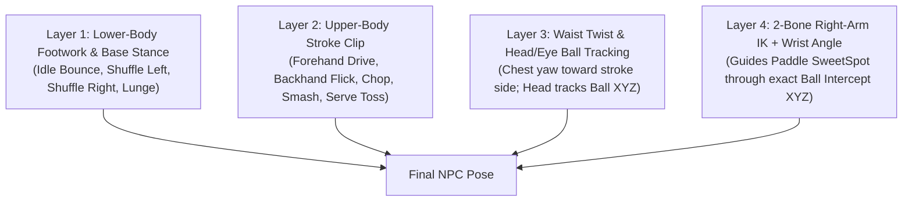

# Table Tennis NPC Opponent — Rigging, Animation, Ball Physics & Runtime IK Guide

This guide specifies how to rig, animate, and drive a live **Table Tennis (Ping Pong) Opponent NPC** at [`cozy_tt_table_indoor_pro.glb`](file:///C:/argon/table_tennis/cozy_tt_table_indoor_pro.glb) or [`cozy_tt_table_outdoor_garden.glb`](file:///C:/argon/table_tennis/cozy_tt_table_outdoor_garden.glb), as well as how to run the **Solo Practice Robot (`cozy_tt_robot_launcher.glb`)** and **Solo Folding Playback Wall**.

---

## 1. Court Coordinate System & Spatial Landmarks

All coordinates are in **Table Station World Space** (where the center of the table floor footprint is `(0.0, 0.0, 0.0)`, the **Player stands at South `-Y`**, and the **NPC stands at North `+Y` facing `-Y`**):

| Landmark / Socket | Station `(X, Y, Z)` | Purpose |
| :--- | :--- | :--- |
| **Table Center (`Root`)** | `(0.000, 0.000, 0.000)` | Floor origin under the center of the net. |
| **Playing Surface (`Z_table`)** | `Z = 0.7600 m` | Regulation playing surface height (`2.74 m` long × `1.525 m` wide). |
| **Table Bounds (`X`, `Y`)** | `X ∈ [-0.7625, +0.7625]`, `Y ∈ [-1.370, +1.370]` | Legal bounce rectangle; `X = 0` is the center doubles line. |
| **Net Top Cord (`Net_Top_Center`)** | `(0.000, 0.000, 0.9125)` | `15.25 cm` above the `0.760 m` table surface (`1.83 m` wide including overhang). |
| **Player Serve Spot (`Serve_Spot_Player`)** | `(0.000, -1.350, 0.761)` | South baseline serve origin. |
| **NPC Serve Spot (`Serve_Spot_NPC`)** | `(0.000, +1.350, 0.761)` | North baseline serve origin. |
| **NPC Baseline Rail (`NPC_Baseline_Center`)** | `X ∈ [-1.15, +1.15]`, `Y ∈ [+1.55, +2.05]`, `Z = 0.0` | Floor zone where the NPC shuffles laterally to intercept incoming shots. |
| **Robot Mount (`Robot_Mount_North`)** | `(0.000, +1.370, 0.761)` | Where [`cozy_tt_robot_launcher.glb`](file:///C:/argon/table_tennis/cozy_tt_robot_launcher.glb) clamps onto the North end for Solo Practice. |

---

## 2. Mandatory NPC Bone Hierarchy (`TT_NPC_Rig`)

Unlike the seated Chess NPC, a Table Tennis NPC stands in an **athletic crouched ready stance** (`knees bent 22°`, `torso pitched forward 15°`, `weight on balls of feet`) and translates laterally along `X` while rotating the waist (`Spine_01`, `Chest`) into **Forehand** and **Backhand** strokes:

```text
Root                              (0.000, +1.720, 0.000) -> (0.000, +1.720, 0.250)  [use_connect=False, slides along X/Y]
 └── Hips                         (0.000, +1.720, 0.880) -> (0.000, +1.720, 1.000)  [use_connect=False, vertical bob & twist]
      ├── Spine_01                (0.000, +1.720, 1.000) -> (0.000, +1.700, 1.180)  [use_connect=True]
      │    └── Chest              (0.000, +1.700, 1.180) -> (0.000, +1.670, 1.380)  [use_connect=True]
      │         ├── Neck          (0.000, +1.670, 1.380) -> (0.000, +1.660, 1.460)  [use_connect=True]
      │         │    └── Head     (0.000, +1.660, 1.460) -> (0.000, +1.580, 1.620)  [use_connect=True, tracks Ball XYZ]
      │         │         └── Eye.L / Eye.R                                         [use_connect=False]
      │         │
      │         ├── Clavicle.R    (-0.040, +1.670, 1.350) -> (-0.180, +1.660, 1.350) [Paddle Arm (World -X when facing -Y)]
      │         │    └── UpperArm.R (-0.180, +1.660, 1.350) -> (-0.260, +1.620, 1.080)
      │         │         └── Forearm.R (-0.260, +1.620, 1.080) -> (-0.220, +1.380, 1.020)
      │         │              └── Hand.R (-0.220, +1.380, 1.020) -> (-0.220, +1.290, 1.020)
      │         │                   └── Paddle_Grip_Socket.R  (Snaps to Paddle `Grab_Handle` (0,0,0))
      │         │
      │         └── Clavicle.L    (+0.040, +1.670, 1.350) -> (+0.180, +1.660, 1.350) [Free / Serve-Toss Hand (World +X)]
      │              └── UpperArm.L -> Forearm.L -> Hand.L -> Ball_Toss_Socket.L
      │
      ├── UpperLeg.R -> LowerLeg.R -> Foot.R  (-0.220, +1.720, 0.000) [Wide athletic stance, 44 cm foot spread]
      └── UpperLeg.L -> LowerLeg.L -> Foot.L  (+0.220, +1.720, 0.000)
```

> [!IMPORTANT]
> **Paddle Attachment Convention:**
> Every standalone paddle ([`cozy_tt_paddle_classic.glb`](file:///C:/argon/table_tennis/cozy_tt_paddle_classic.glb), [`cozy_tt_paddle_carbon_pro.glb`](file:///C:/argon/table_tennis/cozy_tt_paddle_carbon_pro.glb), [`cozy_tt_paddle_cast_iron_pan.glb`](file:///C:/argon/table_tennis/cozy_tt_paddle_cast_iron_pan.glb)) has its origin `Grab_Handle` at `(0, 0, 0)` inside the handle, its blade extending along local `+Z` (`SweetSpot` at `Z = +0.125 m`), its **Forehand (Red/Magenta)** normal pointing along local `-Y`, and its **Backhand (Black/Cyan)** normal pointing along local `+Y`. Parenting the paddle directly to `Paddle_Grip_Socket.R` aligns it with the NPC's hand immediately.

---

## 3. 4-Layer Real-Time NPC Animation Architecture

Table tennis rallies happen at `0.35 – 0.65 seconds` per crossing. To make the NPC look like an agile, believable player at any ball speed or spin, combine 4 layers each frame:



### The 8 Required Baked NPC Clips (`24 fps`)

| # | Clip Name | Frames | Loop? | Keyed Bones & Purpose |
| :--- | :--- | :--- | :--- | :--- |
| 1 | `TT_NPC_Ready_Bounce_Idle` | `1 – 32` | Yes | Athletic split-step rhythm (`Hips` bobbing `±1.8 cm`, knees flexing, paddle held in neutral ready position at `(X=-0.18, Y=+1.38, Z=0.96)`). |
| 2 | `TT_NPC_Footwork_Shuffle_Left` | `1 – 20` | Yes | Chassé side-step toward `-X` (NPC's forehand side), keeping both feet grounded at `Z = 0.000 m` at contact frames. |
| 3 | `TT_NPC_Footwork_Shuffle_Right` | `1 – 20` | Yes | Chassé side-step toward `+X` (NPC's backhand side). |
| 4 | `TT_NPC_Serve_Pendulum_Toss` | `1 – 48` | No | Left hand (`Ball_Toss_Socket.L`) tosses the ball vertically `+26 cm` at frame `10`; right arm draws back and slices through at frame `26`. |
| 5 | `TT_NPC_Forehand_Topspin_Loop` | `1 – 24` | No | Waist coils `+30°`, right arm drops to hip height (`f=1..7`), then whips forward/upward across the body (`f=8..15`, contact at `f=11`), follow-through to forehead (`f=16..24`). |
| 6 | `TT_NPC_Backhand_Drive_Flick` | `1 – 22` | No | Elbow leads in front of stomach (`f=1..6`), forearm & wrist snap forward/upward (`f=7..13`, contact at `f=10`), compact recovery (`f=14..22`). |
| 7 | `TT_NPC_Defensive_Backspin_Chop` | `1 – 26` | No | Open blade angle (`+35°` pitch), high-to-low slicing stroke that imparts heavy backspin. |
| 8 | `TT_NPC_Overhead_Kill_Smash` | `1 – 28` | No | High windup and explosive downward/forward smash against high bouncing lobs (`ballPeakZ > 1.08 m`). |

---

## 4. Ball Flight Physics (Gravity + Drag + Magnus Spin Force)

To make topspin dip sharply onto the table, backspin float long, and sidespin curve laterally (especially visible with [`cozy_tt_ball_twotone_spin.glb`](file:///C:/argon/table_tennis/cozy_tt_ball_twotone_spin.glb)):

- **Ball State:** Position $\mathbf{p} = (x, y, z)$, Velocity $\mathbf{v} = (v_x, v_y, v_z)$ in $\text{m/s}$, Angular Velocity (spin vector) $\boldsymbol{\omega} = (\omega_x, \omega_y, \omega_z)$ in $\text{rad/s}$.
  - **Topspin (when hit by Player toward `+Y`):** $\omega_x < 0$ (creates downward Magnus force $-Z$).
  - **Backspin (when hit by Player toward `+Y`):** $\omega_x > 0$ (creates upward lift $+Z$).
  - **Sidespin:** $\omega_z \neq 0$ (creates lateral curve $\pm X$).
- **Acceleration per Substep ($\Delta t = \frac{1}{120}\text{ s}$):**
  $$\mathbf{a} = (0, 0, -9.81) - k_{\text{drag}} \|\mathbf{v}\| \mathbf{v} + k_{\text{magnus}} (\boldsymbol{\omega} \times \mathbf{v})$$
  where $k_{\text{drag}} = 0.11\text{ m}^{-1}$ and $k_{\text{magnus}} = 0.00045$.
- **Table Bounce (`z - 0.020 <= 0.760` inside `|x| <= 0.7625`, `|y| <= 1.370`):**
  - Play `Ball_Bounce_Squash` on the ball.
  - Invert vertical velocity with restitution $e_z = 0.86$: $v_z' = -0.86 v_z$.
  - Convert spin into forward/lateral kick: $v_y' = 0.82 v_y - 0.0018 \omega_x$, $v_x' = 0.82 v_x + 0.0018 \omega_z$.
- **Net Cord Check (`y` crosses `0.0`):**
  - If $z_{\text{cross}} < 0.9125\text{ m}$ (`Net_Top_Center.z`):
    - If $z_{\text{cross}} \ge 0.892\text{ m}$ (**Net Cord Let / Dribble!**): Play `Table_Net_Cord_Let_Jiggle` on the table, dampen velocity $\mathbf{v} \leftarrow 0.38 \mathbf{v} + (0, 0, 1.2)$ so the ball dribbles over the net!
    - If $z_{\text{cross}} < 0.892\text{ m}$ (**Into the Net**): Play `Table_Net_Cord_Let_Jiggle`, dampen $\mathbf{v} \leftarrow (0.3 v_x, -0.18 v_y, 0.2 v_z)$, point ends.

---

## 5. Drop-In TypeScript Controller (`TableTennisNpcController`)

Below is the complete runtime controller you can drop into your Three.js scene to predict the incoming ball's bounce on the North half (`Y > 0`), slide the NPC along the baseline, select Forehand vs. Backhand vs. Smash, and guide the NPC's paddle sweet-spot through the exact 3D intercept point:

```typescript
import * as THREE from 'three';

export type StrokeType = 'FOREHAND_LOOP' | 'BACKHAND_DRIVE' | 'DEFENSIVE_CHOP' | 'OVERHEAD_SMASH';

export interface InterceptPrediction {
  interceptPos: THREE.Vector3;   // Station-space (X, Y, Z) where NPC paddle meets ball
  interceptTime: number;         // Seconds from now until contact
  bouncePos: THREE.Vector3;      // Where ball bounces on North table half
  peakZ: number;                 // Highest Z after bounce
  recommendedStroke: StrokeType;
}

export class TableTennisNpcController {
  private stationRoot: THREE.Object3D;
  private npcRoot: THREE.Object3D;
  private paddleObj: THREE.Object3D;

  // NPC Bones
  private spineBone?: THREE.Bone;
  private chestBone?: THREE.Bone;
  private headBone?: THREE.Bone;
  private upperArmR?: THREE.Bone;
  private forearmR?: THREE.Bone;
  private handR?: THREE.Bone;

  // Constants
  private readonly TABLE_Z = 0.760;
  private readonly NPC_HOME_POS = new THREE.Vector3(0.0, 1.72, 0.0);
  private readonly PADDLE_READY_OFFSET = new THREE.Vector3(-0.18, -0.34, 0.96);

  // Runtime state
  public npcFloorPos = this.NPC_HOME_POS.clone();
  public paddleTargetLocal = new THREE.Vector3(-0.18, 1.38, 0.96);
  public activeStroke: StrokeType = 'FOREHAND_LOOP';

  constructor(stationRoot: THREE.Object3D, npcRoot: THREE.Object3D, paddleObj: THREE.Object3D) {
    this.stationRoot = stationRoot;
    this.npcRoot = npcRoot;
    this.paddleObj = paddleObj;

    this.npcRoot.position.copy(this.NPC_HOME_POS);
    this.npcRoot.rotation.set(0, Math.PI, 0); // Face -Y toward South player
    this.stationRoot.add(this.npcRoot);

    this.npcRoot.traverse((obj) => {
      if (obj instanceof THREE.Bone) {
        if (obj.name === 'Spine_01') this.spineBone = obj;
        if (obj.name === 'Chest') this.chestBone = obj;
        if (obj.name === 'Head') this.headBone = obj;
        if (obj.name === 'UpperArm.R') this.upperArmR = obj;
        if (obj.name === 'Forearm.R') this.forearmR = obj;
        if (obj.name === 'Hand.R') {
          this.handR = obj;
          this.handR.add(this.paddleObj);
        }
      }
    });
  }

  /**
   * Simulates the incoming ball trajectory forward in 1/120s steps when v.y > 0
   * to find the exact (X, Y, Z) and time where the NPC should strike the ball after it bounces on Y > 0.
   */
  public predictIncomingBall(
    ballPos: THREE.Vector3,
    ballVel: THREE.Vector3,
    ballSpin: THREE.Vector3
  ): InterceptPrediction | null {
    if (ballVel.y <= 0.1) return null; // Ball is moving toward Player, not NPC

    const p = ballPos.clone();
    const v = ballVel.clone();
    const dt = 1 / 120;
    let bouncedOnNorth = false;
    const bouncePos = new THREE.Vector3();
    let peakZ = p.z;

    for (let step = 1; step <= 180; step++) {
      // Gravity + Air Drag + Magnus Spin
      const speed = v.length();
      const magnus = new THREE.Vector3().crossVectors(ballSpin, v).multiplyScalar(0.00045);
      v.x += (-0.11 * speed * v.x + magnus.x) * dt;
      v.y += (-0.11 * speed * v.y + magnus.y) * dt;
      v.z += (-9.81 - 0.11 * speed * v.z + magnus.z) * dt;
      p.addScaledVector(v, dt);

      if (!bouncedOnNorth && p.y > 0.0 && p.y <= 1.37 && Math.abs(p.x) <= 0.7625 && p.z - 0.02 <= this.TABLE_Z && v.z < 0) {
        bouncedOnNorth = true;
        p.z = this.TABLE_Z + 0.02;
        v.z = -0.86 * v.z;
        v.y = 0.82 * v.y - 0.0018 * ballSpin.x;
        v.x = 0.82 * v.x + 0.0018 * ballSpin.z;
        bouncePos.copy(p);
      }

      if (bouncedOnNorth) {
        peakZ = Math.max(peakZ, p.z);
        // Ideal strike window: near the top of the bounce or as ball reaches Y = 1.25..1.55m
        if (p.y >= 1.25 || v.z <= 0.05) {
          // Since NPC faces -Y, NPC's right (Forehand) is -X and left (Backhand) is +X
          let stroke: StrokeType = p.x <= this.npcFloorPos.x + 0.05 ? 'FOREHAND_LOOP' : 'BACKHAND_DRIVE';
          if (peakZ > 1.08) stroke = 'OVERHEAD_SMASH';
          else if (p.y > 1.50 && p.z < 0.86) stroke = 'DEFENSIVE_CHOP';

          return {
            interceptPos: p.clone(),
            interceptTime: step * dt,
            bouncePos,
            peakZ,
            recommendedStroke: stroke,
          };
        }
      }
    }
    return null;
  }

  /**
   * Computes the initial velocity & spin vector to launch a returned ball from `hitPos`
   * so it lands cleanly at `targetSouthBounce` (X in [-0.65, +0.65], Y in [-1.15, -0.45], Z = 0.78).
   */
  public computeReturnShotVelocity(
    hitPos: THREE.Vector3,
    targetSouthBounce: THREE.Vector3,
    flightTime = 0.42
  ): { velocity: THREE.Vector3; spin: THREE.Vector3 } {
    const dx = targetSouthBounce.x - hitPos.x;
    const dy = targetSouthBounce.y - hitPos.y;
    const dz = targetSouthBounce.z - hitPos.z;
    // Account for gravity + drag over flightTime
    const vx = (dx / flightTime) * 1.08;
    const vy = (dy / flightTime) * 1.08;
    const vz = (dz + 0.5 * 9.81 * flightTime * flightTime) / flightTime;

    const spin = new THREE.Vector3(
      this.activeStroke === 'DEFENSIVE_CHOP' ? -45.0 : +65.0, // Topspin vs Backspin
      0.0,
      THREE.MathUtils.randFloatSpread(20.0)
    );
    return { velocity: new THREE.Vector3(vx, vy, vz), spin };
  }

  /** Call every frame to move NPC feet, track ball with head, and solve paddle arm IK */
  public updateFrame(dt: number, liveBallPos: THREE.Vector3, prediction: InterceptPrediction | null): void {
    // 1. Lateral Footwork Shuffle along North baseline
    const desiredFootX = prediction
      ? THREE.MathUtils.clamp(
          prediction.interceptPos.x + (prediction.recommendedStroke === 'FOREHAND_LOOP' ? 0.22 : -0.14),
          -1.15,
          1.15
        )
      : 0.0;
    const desiredFootY = prediction
      ? THREE.MathUtils.clamp(prediction.interceptPos.y + 0.34, 1.48, 2.05)
      : 1.72;

    this.npcFloorPos.x = THREE.MathUtils.lerp(this.npcFloorPos.x, desiredFootX, Math.min(1, dt * 7.5));
    this.npcFloorPos.y = THREE.MathUtils.lerp(this.npcFloorPos.y, desiredFootY, Math.min(1, dt * 6.0));
    this.npcRoot.position.copy(this.npcFloorPos);

    // 2. Smoothly guide Paddle Target toward Intercept Point (or Ready Position)
    const desiredPaddlePos = prediction
      ? prediction.interceptPos
      : new THREE.Vector3(
          this.npcFloorPos.x + this.PADDLE_READY_OFFSET.x,
          this.npcFloorPos.y + this.PADDLE_READY_OFFSET.y,
          this.PADDLE_READY_OFFSET.z
        );
    this.paddleTargetLocal.lerp(desiredPaddlePos, Math.min(1, dt * 14.0));

    // 3. Head tracks live ball
    if (this.headBone) {
      const headWorld = new THREE.Vector3();
      this.headBone.getWorldPosition(headWorld);
      const ballWorld = this.stationRoot.localToWorld(liveBallPos.clone());
      const dir = ballWorld.sub(headWorld).normalize();
      const yaw = Math.atan2(-dir.x, -dir.y);
      const pitch = Math.asin(THREE.MathUtils.clamp(dir.z, -0.6, 0.6));
      this.headBone.rotation.y = THREE.MathUtils.clamp(yaw * 0.7, -0.75, 0.75);
      this.headBone.rotation.x = THREE.MathUtils.clamp(-pitch * 0.7, -0.55, 0.55);
    }
  }
}
```
